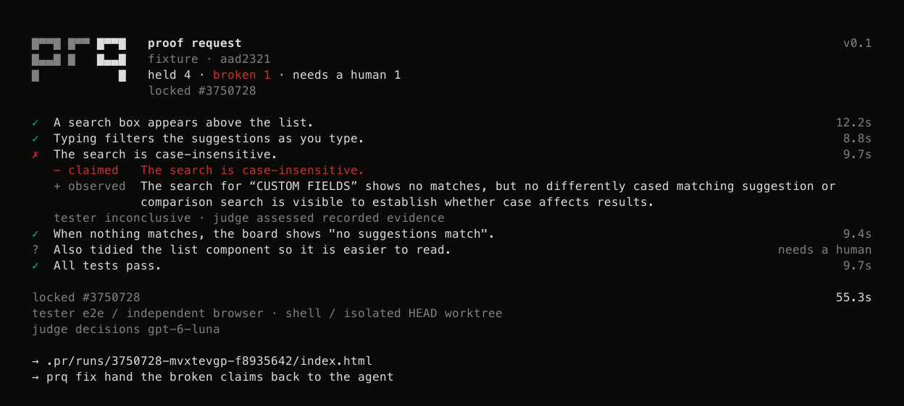

# prq

**Your agent said it works. Prove it.**

[](https://www.npmjs.com/package/@alterok/prq)
[](LICENSE)
[](SPEC.md)



`prq` checks what a coding agent says it finished. It locks the claims in the agent's own words, runs independent browser or command checks, and opens a report with evidence behind each verdict. The tester never sees the author's reasoning. A separate judge reviews the evidence without source files.

CLI output replayed from a deliberately seeded demo. [Evidence and limitations](examples/search/README.md).

## Try it

Use Node.js 24.8+, npm, Git, and an OpenAI API key with [required model access](docs/user-guide.md#requirements). Work inside your app's Git repository with a committed `HEAD` and installed dependencies.

Install the CLI once in your project:

```sh
npm install --save-dev @alterok/prq
```

For browser checks, also prepare the project:

```sh
export OPENAI_API_KEY="your-key"
npm install --save-dev e2e@0.22.0 @e2e-dev/web@0.15.4 @ai-sdk/openai@4.0.106 ai@7.0.158
npx --no-install e2e-web install chromium
npx prq init
```

Start your app with its usual development command. Save the agent's completion message as `done.md`, then run:

```sh
npx prq --claims done.md --app-url http://localhost:3000
```

`prq` uses an already running app. Command-only checks can skip browser installation and `init`.

## What you get

Results appear in the terminal. A local HTML report lets you inspect screenshots, steps and command output.

Reports stay in `.pr/runs/<run-id>/`. Models receive the completion message and selected evidence. See [privacy and execution boundaries](docs/user-guide.md#privacy-and-execution-boundaries) before sharing application data.

## Fix and check again

```sh
npx prq fix       # broken claims as a prompt for your agent
# Apply the fix. Commit it before command checks.
npx prq rerun     # same locked claims, fresh evidence
npx prq open      # reopen the latest report
```

Browser setup actions may replay from cache. Assertions run live.

| Verdict | Meaning |
| --- | --- |
| ✓ held | A completed check and its evidence support the claim. |
| ✗ broken | A completed check or evidence contradicts it. |
| ? needs a human | The claim is subjective or evidence is ambiguous. |
| ○ unverified | Execution or evidence was insufficient to decide. |

[User guide](docs/user-guide.md) · [Spec](SPEC.md) · [Benchmarks](bench/external/README.md) · [Contributing](docs/contributing.md)

[Apache-2.0](LICENSE).
