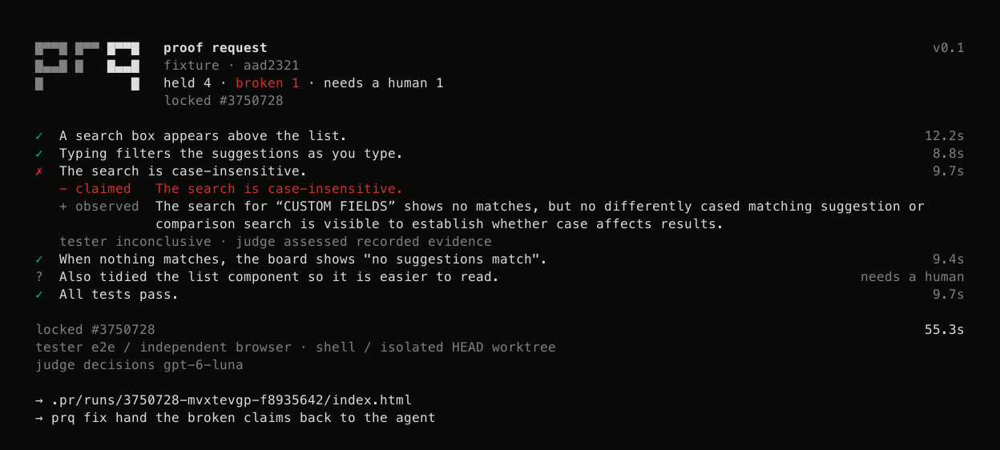

# prq

**Your agent said it works. Prove it.**



`prq` checks a coding agent's completion message, locks its claims, and saves evidence for each verdict. Fix the application, then rerun the same claims.

CLI output replayed from a [deliberately seeded search demo](https://github.com/alterokhq/prq/tree/main/examples/search). The browser tester was inconclusive about case sensitivity; the separate judge marked the claim broken from recorded evidence. The saved artifact retains both outcomes.

Use Node.js 24.8+, npm, Git, and an OpenAI key with access to `gpt-6.1-sol` and Decisions `gpt-6-luna`. Run inside your application's Git repository with a committed `HEAD` and installed dependencies.

Install the CLI once in your project, then use `npx prq`:

```sh
npm install --save-dev @alterok/prq
```

For browser checks:

```sh
export OPENAI_API_KEY="your-key"
npm install --save-dev e2e@0.22.0 @e2e-dev/web@0.15.4 @ai-sdk/openai@4.0.106 ai@7.0.158
npx --no-install e2e-web install chromium
npx prq init
```

Start the app separately and save the agent's message as `done.md`:

```sh
npx prq --claims done.md --app-url http://localhost:3000
npx prq fix
# Apply the fix. Commit it before command checks.
npx prq rerun
```

Reports stay in `.pr/runs/`. Browser assertions run live; command checks cover committed `HEAD` in a temporary checkout, not a security sandbox. Command-only checks can skip browser setup. Screenshots and interaction evidence go to model providers.

[User guide](https://github.com/alterokhq/prq/blob/main/docs/user-guide.md) · [Spec](https://github.com/alterokhq/prq/blob/main/SPEC.md) · [Source](https://github.com/alterokhq/prq) · [Apache-2.0](https://github.com/alterokhq/prq/blob/main/LICENSE)
